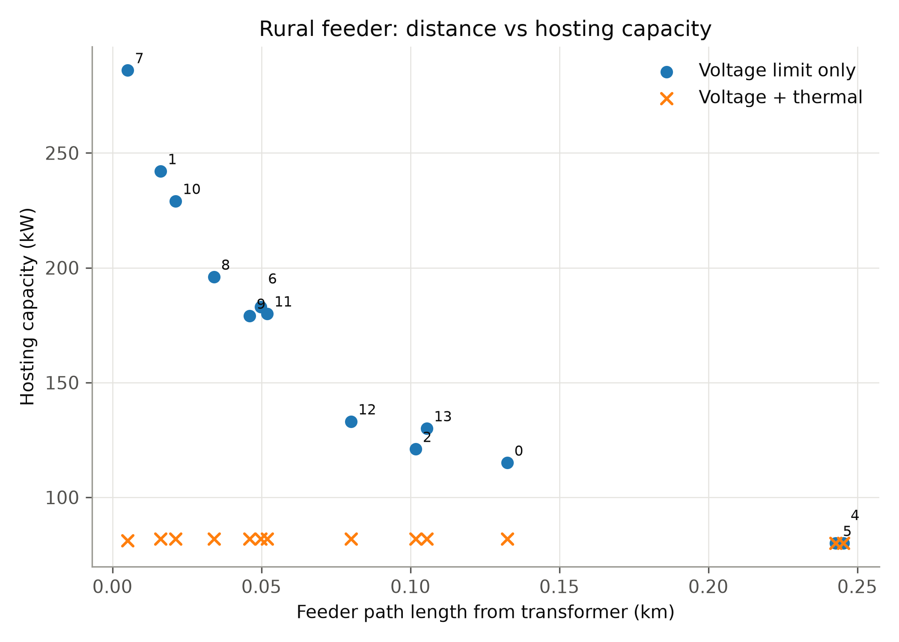
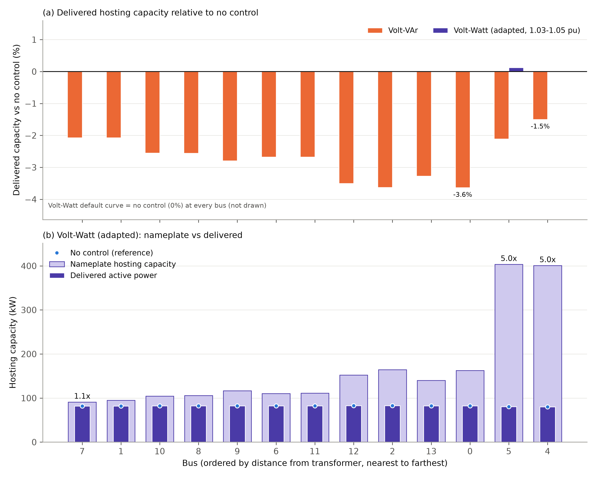
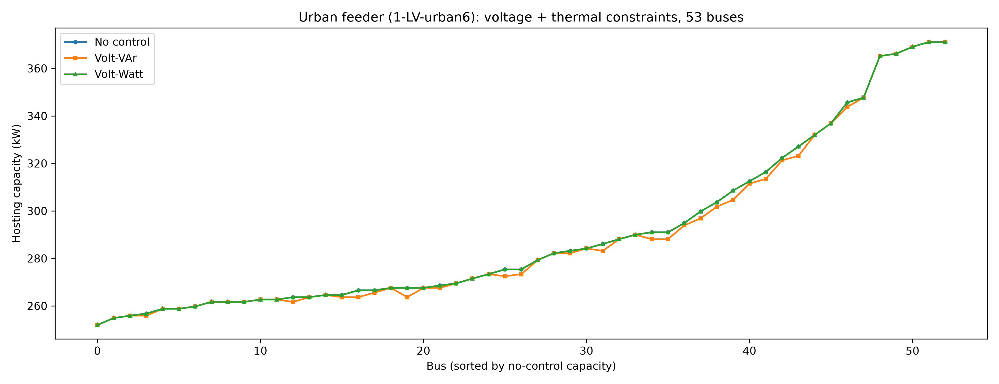
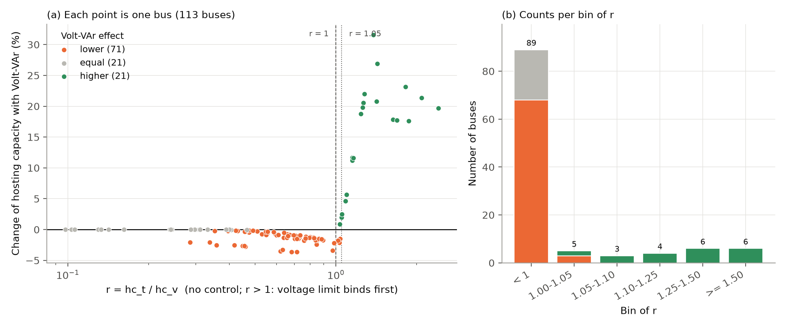
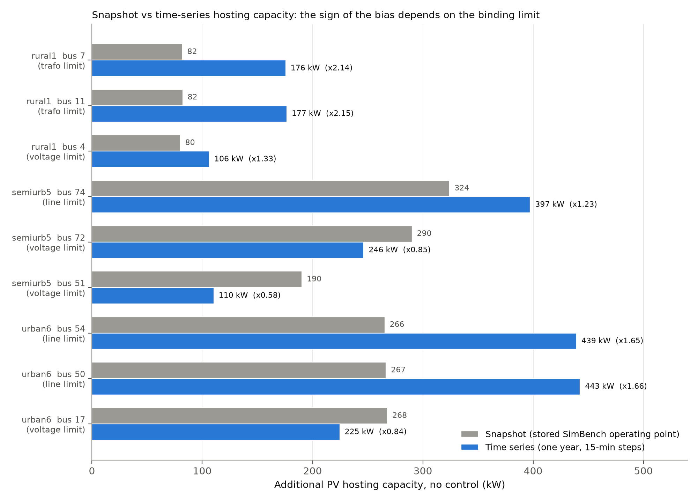
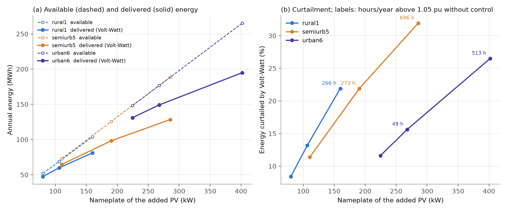

# When Does Volt-VAr Raise PV Hosting Capacity in Low-Voltage Feeders? A Screening Rule Tested at SimBench Study Cases and over One Year

**Sattar Safabakhsh**

Independent Researcher, Susangerd, Khuzestan, Iran

Correspondence: sattarsafabakhsh.eng@gmail.com

## Abstract
Volt-VAr control is proposed to raise PV hosting capacity (HC) in low-voltage (LV) feeders, but most studies enforce voltage limits alone. We ask when the default IEEE 1547 Volt-VAr curve raises or lowers HC under voltage (1.05 pu) and thermal (100% loading) limits together, and whether a snapshot rule predicts the result over a year. On six SimBench LV networks (113 buses), Volt-VAr never raised HC where the thermal limit binds first and raised it where the voltage limit binds first, unless the thermal limit was close. The ratio r of thermal-only to voltage-only HC, from two searches without control, separated the cases: no gain for r < 1, gain for r ≥ 1.05. At the stored SimBench operating point, with all PV at full output, the snapshot gave the one-year sign of the Volt-VAr effect at only 4 of 9 buses. At the SimBench low-load study case (load 10%, PV 80%), it gave the sign at 9 of 9, as predicted before the run. Over the year, Volt-VAr raised HC by 55–74% at the four voltage-limited buses and lowered it by 0.6–4.0% at the five thermally limited ones. The German cos φ(P) characteristic gained less (8–21%).

**Keywords:** hosting capacity; low-voltage networks; photovoltaic; Volt-VAr control; cos φ(P); thermal limits; screening indicator; study cases; time series; SimBench

## 1. Introduction

Increasing penetration of rooftop photovoltaic (PV) systems in low-voltage
(LV) distribution networks is often constrained by voltage rise, a
phenomenon extensively studied under the term "hosting capacity" (HC).
Smart inverter functions — particularly Volt-VAr and Volt-Watt control
per IEEE 1547-2018 [1] — have been proposed to mitigate this constraint. HC is the amount of new generation that a network can accept before a performance limit is exceeded [2]. Reviews of HC assessment methods and enhancement techniques are given in [3], and deterministic and stochastic HC methods for LV networks are compared in [4]. Reactive power support from smart inverters can raise HC [5]. Jaramillo-Leon et al. [6] optimize the siting and smart inverter settings of PV plants on a real feeder, and their best case uses Volt-VAr control.

However, in the studies reviewed here, control strategies are mostly
evaluated under voltage constraints alone. For example, Alfouly et al. [7] use a single simplified test network, do not report hosting capacity in kW, and do not report line or transformer loading.
Transformer thermal limitations have been independently recognized as a
critical HC constraint: Ame-Oko and Lavrova [8] address this via
transformer loading and degradation considerations, while Qamar et al. [9], in a comprehensive
review, note that DSOs in several countries (e.g., Portugal <25%, Spain
<50% and Italy <65% of the MV/LV transformer rating) impose hard limits
on DG capacity as a fraction of transformer rating, confirming the
practical relevance of this constraint. Lliuyacc Blas and Kepplinger [10] include overvoltage, overcurrent and transformer overloading in an HC method that they test on 14 Austrian LV grids. In a city-level study of more than 300 Swedish LV networks, line loading did not limit HC [11]. Dissanayake et al. [12] combine voltage control with dynamic line rating on an urban low-voltage network in Sri Lanka but evaluate a single 25-node network. Karunarathne et al. [13] combine coordinated voltage control with dynamic line rating on a real Sri Lankan network. Chathurangi et al. [14] compare Volt-VAr and Volt-Watt control under different connection standards and show that their benefit depends on inverter location, but do not examine the interaction between reactive power support and
transformer thermal limits. Demirok et al. [15] compare local reactive power methods, such as cos φ(P) and Q(U), on a suburban LV network. Schultis [16] compares local Volt/var strategies on LV feeders under voltage and current limits; the inverter-based methods gave smaller HC gains, and cos φ(P) control caused high extra current. A single snapshot cannot show how often or how long a limit is exceeded; quasi-static time-series (QSTS) analysis can [17,18]. In a case study, dynamic HC from one year of power flows was 60% to 200% higher than static HC [18]. On an LV feeder, time-series HC also differed from snapshot HC [19].

To the best of our knowledge, and within the literature reviewed, none of
these studies directly compares Volt-VAr and Volt-Watt control under
simultaneous voltage and thermal constraints across multiple realistic network
topologies, or checks whether a snapshot rule for the Volt-VAr effect holds
over a year of load and PV profiles, and how the snapshot operating point
changes the answer. This study addresses these gaps and asks one question:

> **When does the default Volt-VAr curve help or hurt PV hosting capacity
> in LV feeders, and can a simple snapshot indicator predict it over a year?**

The question is answered in four steps. Study 1 (Sections 3.1–3.6)
analyses two feeders in detail, bus by bus, with all control scenarios and
direct flow measurements at the binding element. Study 2a (Section 3.7)
extends the snapshot analysis to six networks and 113 buses and tests a
hypothesis and a screening indicator. Study 2b (Section 3.8) repeats the
capacity calculation with one year of 15-minute profiles on three feeders
and examines annual energy, curtailment, limit violations and losses. Section 3.9 adds Volt-VAr to the year-based search at the far buses. Study 3 (Sections 3.10–3.12) repeats the snapshot at two SimBench study cases with low load and high PV, adds three control variants (the German cos φ(P) characteristic, Volt-VAr on all PV units and an inverter apparent-power limit) and extends the year-based search to nine buses. The
contributions are:

1. Hosting capacity in kW, bus by bus, on six SimBench LV networks under
   combined voltage and thermal limits, with the Volt-VAr effect split into a
   gain on the voltage limit and a penalty on the thermal limit. The capacity
   equals the smaller of the two at every bus tested (113 of 113 at each
   operating point of Sections 3.7 and 3.10, 180 of 180 in the held-out test).
2. A screening indicator r = HC(thermal only) / HC(voltage only), from two
   searches without control. At the stored operating point, at two held-out
   scenarios and at two SimBench study cases, Volt-VAr never raised HC for
   r < 1 and raised it at every bus with r ≥ 1.05 (Sections 3.7 and 3.10).
3. Evidence that the snapshot operating point decides whether the rule holds
   over a year. At the stored point the snapshot gave the year sign of the
   Volt-VAr effect at 4 of 9 buses; at the low-load study case lW it gave the
   sign at 9 of 9 (predictions fixed before the run; Section 3.12).
4. One year of 15-minute steps at nine buses: Volt-VAr raised HC by 55% to 74%
   at the four voltage-limited buses and lowered it by 0.6% to 4.0% at the
   five thermally limited buses. The German cos φ(P) characteristic gained less
   (8% to 21%), although it gained more than Volt-VAr in the study-case
   snapshot at most voltage-first buses.
5. Measured flows at the binding element that explain the thermal penalty of
   Volt-VAr; a snapshot bias whose sign depends on the binding limit; and the
   difference between nameplate and delivered HC with a tuned Volt-Watt curve,
   which curtails 8% to 32% of the energy over a year.

## 2. Materials and Methods
Sections 2.1–2.5 describe the models and the search used throughout; Sections 2.6 to 2.8 describe the three extensions.

### 2.1 Network Models and Operating Point
The study uses the SimBench dataset [20] (University of
Kassel, Fraunhofer IEE, RWTH Aachen, TU Dortmund). Unlike standard
synthetic test systems (e.g., IEEE 33-bus), SimBench networks are derived
from real German DSO planning principles. Power flow uses pandapower's
Newton-Raphson solver [21].

The two feeders are:

- **Rural:** SimBench code: 1-LV-rural1--0-sw; transformer: 160 kVA; loads: 13 loads, 80 kW; existing PV: 4 units, 160.4 kW; base trafo loading: 52.5% (transformer export 78.9 kW at the HV side; bus balance 80.4 kW; the 1.4 kW difference is network losses).
- **Urban:** SimBench code: 1-LV-urban6--0-sw; transformer: 630 kVA; loads: 111 loads at 53 load buses, 441 kW; existing PV: 5 units, 57.1 kW; base trafo loading: 67.7% (transformer import 392.2 kW at the HV side; bus balance 383.9 kW; the 8.3 kW difference is network losses).

All values are those stored in the SimBench network files (the slack
voltage is 1.025 pu). In Sections 3.1–3.7 the analysis is a single
deterministic snapshot at this stored operating point: loads and existing
PV units take their stored values, and no time-series or study-case scaling
is applied. Hosting capacity is the **additional** PV that can be connected
at one load bus on top of the existing generation. Sections 2.6 to 2.8
extend the analysis to six networks, to one year of 15-minute profiles and
to SimBench study cases.

### 2.2 Constraints
- **Voltage:** maximum bus voltage ≤ 1.05 pu. This is a conservative
  planning limit, not the EN 50160 [22] limit: EN 50160 permits ±10% of
  nominal voltage at LV. A limit of 1.10 pu is therefore also evaluated
  as a sensitivity case. Only the upper limit is enforced, since PV
  injection raises voltages.
- **Thermal:** line loading (`res_line.loading_percent`) and transformer
  loading (`res_trafo.loading_percent`) ≤ 100%. Both are current-based
  (pandapower default `trafo_loading="current"`): the transformer loading
  is the larger of the HV and LV currents relative to the rated current.
  Because I = S / (√3 · V), at the LV voltage of about 1.03 pu found at
  the capacity limit, a loading of 100% corresponds to an apparent power
  of about 103% of the rated value.

A candidate PV size is feasible only if all constraints hold
simultaneously.

### 2.3 Hosting Capacity Definitions and Search
For each load bus, a PV generator (sgen) is added and its size increased
until a constraint is violated. Two quantities are reported:

- **Nameplate HC:** the largest installed PV size that is feasible.
- **Delivered HC:** the active power actually injected at that size after
  any curtailment by the control function.

Without curtailment the two are equal. Feasibility is assumed to be
monotonic in PV size, so the largest feasible size is found by binary
search with 0.1 kW tolerance (upper bound 2000 kW on all networks), about
15 search steps per bus and scenario (log2(2000/0.1) ≈ 14.3). The distance from each bus to the transformer
was computed with pandapower's `calc_distance_to_bus`, which returns the
path length in km. Since all lines on the rural feeder are the same cable
type (NAYY 4x150SE), path length is a valid proxy for electrical distance
there.

### 2.4 Control Scenarios
Only the added PV unit is controlled; the existing PV units are
uncontrolled, so that the effect of the control is isolated on the added unit. Reactive power is expressed per unit of the PV nameplate,
and no inverter apparent-power limit is imposed (S reaches up to about
1.09 times the nameplate under Volt-VAr). The curves are the IEEE 1547-2018 defaults [1]. European connection rules for LV generators [23,24] set their own reactive power requirements; these are not modelled here.

The four control scenarios are:

- **NC:** No control (unity power factor).
- **VVAR:** IEEE 1547-2018 default Volt-VAr curve.
- **VW default:** IEEE 1547-2018 default Volt-Watt curve.
- **VW adapted:** Volt-Watt curve starting earlier, at 1.03 pu.

**Volt-VAr.** The curve is Equation (2) in Section 2.5. Voltage and reactive power are mutually dependent, so each power flow is
solved iteratively (up to 20 iterations, convergence when Q changes by
less than 0.1 kvar). A candidate that does not converge is treated as
infeasible.

**Volt-Watt.** Active power ratio falls linearly from 1.0 at VW1 to 0.2 at
VW2. Default: VW1=1.06, VW2=1.10 pu. Adapted: VW1=1.03, VW2=1.05 pu.
The delivered power is the equilibrium of P = P_nameplate · w(V(P)), found
by bisection. Because voltage increases with injected power and w is
non-increasing in voltage, the residual is strictly decreasing in P, so
the equilibrium is unique (for a radial feeder with a single controlled
injection).

### 2.5 Mathematical Formulation

**Hosting capacity.** For each bus b, with the added PV of nameplate $P_n$:

$$\mathrm{HC}_b = \max P_n \quad \text{s.t.} \quad V_j \le V_{\max}\ \forall j, \quad \frac{I_l}{I_{\max,l}} \le 1\ \forall l, \quad \frac{I_t}{I_{\mathrm{r},t}} \le 1\ \forall t \qquad (1)$$

where $V_{\max}$ = 1.05 pu (1.10 pu as a sensitivity case) and $I_t = \max(I_{\mathrm{HV}}, I_{\mathrm{LV}})$. The delivered capacity is $P_{\mathrm{del}} = P_n \, w(V_b(P_{\mathrm{del}}))$, where $w$ is the Volt-Watt active power ratio of Equation (3), with $w \equiv 1$ for NC and VVAR. (The symbol r is kept for the screening ratio of Section 2.6.)

**Volt-VAr law** (piecewise linear, per unit of nameplate):

$$Q(V) = \begin{cases} Q_1, & V \le V_1 \\ Q_1 + (Q_2 - Q_1)\dfrac{V - V_1}{V_2 - V_1}, & V_1 < V \le V_2 \\ Q_2, & V_2 < V \le V_3 \\ Q_3 + (Q_4 - Q_3)\dfrac{V - V_3}{V_4 - V_3}, & V_3 < V \le V_4 \\ Q_4, & V > V_4 \end{cases} \qquad (2)$$

with $(V_1, V_2, V_3, V_4)$ = (0.92, 0.98, 1.02, 1.08) pu and $(Q_1, Q_2, Q_3, Q_4)$ = (+0.44, 0, 0, −0.44).

**Volt-Watt law:**

$$w(V) = \begin{cases} 1, & V \le V_{W1} \\ 1 + (P_{W2} - 1)\dfrac{V - V_{W1}}{V_{W2} - V_{W1}}, & V_{W1} < V < V_{W2} \\ P_{W2} = 0.2, & V \ge V_{W2} \end{cases} \qquad (3)$$

**Transformer current and apparent power.** The transformer loading is
current-based, and the current is I = S / (√3 · V) with
S = √(P² + Q²). For a fixed active power flow P and voltage V, any
non-zero reactive flow Q raises S and therefore the current and the
loading. Reactive absorption by the inverter changes the Q drawn through
the transformer, which is the mechanism measured in Section 3.6.

### 2.6 Multi-Network Snapshot Study
The snapshot analysis was extended to six SimBench LV networks (scenario 0,
`-sw` variants). The same limits (1.05 pu, 100% current-based loading), the
same binary search (0.1 kW tolerance, 2000 kW ceiling) and the same
Volt-VAr model as in Sections 2.2–2.4 are used. Table 1 lists the six networks.

**Table 1.** The six SimBench LV networks (scenario 0, stored operating point, without the added PV).

| Network | Buses | Transformer (kVA) | Loads (kW) | Existing PV (kW) | Load buses | Base max. voltage (pu) | Base max. line loading (%) | Base trafo loading (%) |
|---|---|---|---|---|---|---|---|---|
| rural1 | 15 | 160 | 80.0 | 160.4 | 13 | 1.0265 | 41.0 | 52.5 |
| rural2 | 97 | 250 | 202.0 | 145.4 | 93 | 1.025 | 48.5 | 39.6 |
| rural3 | 129 | 400 | 331.0 | 190.4 | 118 | 1.025 | 30.9 | 48.6 |
| semiurb4 | 44 | 400 | 243.0 | 6.5 | 39 | 1.025 | 63.1 | 64.8 |
| semiurb5 | 111 | 630 | 409.0 | 137.1 | 104 | 1.025 | 45.1 | 50.7 |
| urban6 | 59 | 630 | 441.0 | 57.1 | 53 | 1.025 | 56.6 | 67.7 |

The base case of every network satisfies both limits. **Bus sample:** all 13
load buses of rural1, and 20 load buses of each other network, evenly spaced
by electrical distance (path impedance) from the transformer so that near and
far buses are both included; 113 buses in total. The sample is not random and
does not cover all buses; it was limited by computation time.

**Quantities per bus.** Six capacities are computed (kW, nameplate):

- **hc_v:** control: none; limits enforced: voltage only.
- **hc_t:** control: none; limits enforced: thermal only (lines and transformer).
- **hc_nc:** control: none; limits enforced: both.
- **hc_vvar:** control: default Volt-VAr; limits enforced: both.
- **hc_v_vvar:** control: default Volt-VAr; limits enforced: voltage only.
- **hc_t_vvar:** control: default Volt-VAr; limits enforced: thermal only.

From these:

- **First limit** without control: *voltage* if hc_v < hc_t − 0.2 kW,
  *thermal* if hc_t < hc_v − 0.2 kW, otherwise *both* (not observed).
- **Effect** of Volt-VAr: *higher* if hc_vvar exceeds hc_nc by more than
  0.2 kW, *lower* if it is below by more than 0.2 kW, otherwise *equal*
  (0.2 kW is twice the search tolerance).
- **Gain** g = (hc_v_vvar − hc_v) / hc_v and **penalty**
  p = (hc_t − hc_t_vvar) / hc_t, the effect of Volt-VAr on each limit alone.
- **Screening indicator** r = hc_t / hc_v. It uses only searches without
  control. r > 1 means that the voltage limit binds first.
- **Thermal element:** the element (line or transformer) at 100% loading at
  hc_t.
- **Dead-band check:** the voltage at the PV bus at the uncontrolled
  capacity hc_nc, compared with the upper dead-band edge of 1.02 pu.

**Consistency checks.** hc_nc = min(hc_v, hc_t) and
hc_vvar = min(hc_v_vvar, hc_t_vvar), each within 0.2 kW, and the number of
buses at which a search reached the 2000 kW ceiling.

**Hypothesis (stated before the run).** Volt-VAr cannot raise HC where the
thermal limit binds first. Where the voltage limit binds first, it raises HC
unless the thermal limit is close behind.

**Note on the gain.** Where the voltage limit does not bind first, hc_v is
large (several hundred kW or more) and the Volt-VAr iteration may fail to
converge, so hc_v_vvar there is a numerical limit and not a physical one.
The gain is therefore reported only for buses where the voltage limit binds
first.

**Held-out test.** The rules were then tested on operating points that were not used to derive them. SimBench 1-LV contains only the six networks above, so the test uses scenarios 1 and 2 of the same six networks (Section 3.7.8). The predictions were written on 21 October 2026, before the run. The same functions and thresholds were used, without refitting: P1, with r < 1 Volt-VAr is never higher than no control; P2, with r ≥ 1.05 Volt-VAr is higher at every bus where the voltage limit binds first; P3, where the voltage at the uncontrolled capacity is at most 1.02 pu Volt-VAr is unchanged; P4, hc_nc and hc_vvar equal the smaller of their two parts within 0.2 kW at every bus. The 1.00–1.05 band was expected to be mixed. An earlier design with five other networks was dropped before any run, because those grids do not exist in SimBench 1-LV.

### 2.7 Time-Series Study
Three networks are used: rural1, semiurb5 and urban6 (scenario 0), with three
load buses each (near, middle and far along the electrical distance from the
transformer; nine buses). The control is no control in the capacity search
(Q1) and the tuned Volt-Watt curve (1.03–1.05 pu, floor 0.2) in the energy
analysis (Q2). Volt-VAr is added to the capacity search at the far buses (Section 3.9) and, in Study 3, at all nine buses (Section 2.8).

**Profiles.** SimBench absolute values for the same network (35,136
15-minute steps of the leap year 2016): load active and reactive power and
the active power of the existing PV units. The added PV follows the
fleet-average PV profile f(t), the sum of the existing PV profiles divided by
the sum of their nameplates, scaled to the nameplate of the added unit. f(t)
never exceeds 0.59 (maximum 0.576 on rural1, 0.587 on semiurb5, 0.582 on
urban6). Existing PV remains uncontrolled. Daylight steps are those with
f > 0.001 (about 14,300 to 15,000 per year).

**Q1: time-series capacity (15-minute steps, no control).** The capacity is
the largest nameplate at which no limit is violated at any daylight step.
Checking all steps for every candidate would be slow, so a critical-step
method is used: daylight steps are ranked by the net feeder injection plus a
share of the added PV; the worst 100 steps form a critical set; the capacity
is found by bisection on that set; it is then checked on a verification set
(the worst 1500 steps and 500 random daylight steps); any violating step is
added to the critical set and the search is repeated, up to eight rounds,
until the capacity holds on the verification set. The result is rounded down
to 0.1 kW. A step that violates a limit without the added PV is excluded and
counted. *Validation:* for rural1 bus 4 (106.5 kW), a check of all 14,278
daylight steps found 0 violations. A result rounded up to 106.6 kW, by
contrast, gave one violating step in the same check, which is why results are
rounded down.

**Q2: energy, curtailment, violations and losses (hourly means, daylight
hours).** At the far bus of each feeder three nameplate sizes are used: the
snapshot capacity, the time-series capacity and 1.5 times the larger of the
two. One pass over the daylight hours gives:

- *available energy*, the energy of the added PV without curtailment;
- *delivered energy* with the tuned Volt-Watt curve, the delivered power in
  each hour being the Volt-Watt equilibrium found by bisection;
- *curtailed share*, 1 − delivered / available, and *full-load hours*,
  delivered energy divided by nameplate;
- *violation hours* (voltage and thermal) without control and with Volt-Watt,
  counted only for hours in which the limit is violated with the added PV
  and not without it;
- *added losses*, the annual network losses with the added PV minus those
  without it, without control and with Volt-Watt;
- *marginal energy*, the delivered energy gained per extra kW of nameplate
  between two sizes.

**Binding-step conditions.** For each bus of Q1, the total load
and the PV factor at the step that binds the capacity, compared with the
stored (snapshot) load and with the largest load of the year.

**Volt-VAr capacity over the year.** At the far bus of each feeder, the search of Q1 is repeated with the default Volt-VAr curve in every power flow (the iteration of Section 2.4), with the same critical set, verification set, random seed and skip list. Unlike Q1, the final capacity is checked on every daylight step, and a power flow that does not converge counts as a violation. A repeated snapshot search checks the code at the stored operating point, and that point is compared with the one-year profiles (Section 3.9).

### 2.8 Study Cases, Control Variants and Nine Buses over a Year (Study 3)
**Study cases.** SimBench defines study cases with scaling factors for load and generation [20]. Two of them have low load and high PV: lW (load 10%, PV 80%) and lPV (load 10%, PV 95%). Their slack voltage is 1.055 pu. This is above the 1.05 pu limit, so every base case violates the limit before any PV is added. The snapshot therefore takes the load and PV factors of each case and keeps the stored slack voltage of 1.025 pu, as the year profiles of Section 2.7 do. Only the operating point of loads and PV changes. The added unit has nameplate Pn and injects P = f_pv · Pn, where f_pv is the PV factor of the case. Volt-VAr uses Q = ratio(V) · Pn. The limits, the search, the bus sample and the derived quantities are those of Section 2.6. The nine buses of Section 2.7 are added at each study case and at the stored point.

**Control variants.** Three variants are added. (i) A cos φ(P) characteristic of the type in VDE-AR-N 4105 [24] on the added unit, Equation (4). It uses no voltage input:

$$\cos\varphi = \begin{cases} 1, & P \le 0.5\,P_n \\ 1 - 0.2\,(P/P_n - 0.5), & 0.5\,P_n < P \le P_n \end{cases}, \qquad Q = -P\tan\varphi \qquad (4)$$

 (ii) The default Volt-VAr curve on every PV unit, existing and added, each on its own bus voltage. (iii) Volt-VAr on the added unit with an apparent-power limit S = Pn and active-power priority, |Q| ≤ √(Pn² − P²).

**Nine buses over a year.** The year-based search of Section 2.7 (Q1) is repeated at the near, middle and far bus of each feeder, with Volt-VAr and with cos φ(P). As in Section 3.9, the final capacity is checked on every daylight step. The far-bus Volt-VAr capacities are those of Section 3.9.

**Comparison and predictions.** For each of the nine buses and each snapshot operating point (stored, lW and lPV), the sign of the snapshot effect and the rule of r are compared with the sign of the year effect. The sign is higher, equal or lower, with the 0.2 kW tolerance of Section 2.6. The predictions were written before the runs: P5, the rules of Section 2.6 hold at each study case; P6, the S limit changes no result where f_pv ≤ 0.898, because then √(1 − f_pv²) ≥ 0.44; P7, with Volt-VAr on all PV units the median change is not higher at thermal-first buses and not lower at voltage-first buses than with one controlled unit; P8, over the year Volt-VAr is higher than no control at the four voltage-limited buses of Table 11 and not higher at the five others; P9, the study-case snapshot agrees with the year sign at more of the nine buses than the stored point; P10, over the year cos φ(P) gains less than Volt-VAr at each voltage-limited bus.

**Use of generative AI.** Claude (Anthropic; models Claude Haiku 5.5 and Claude Opus 5.5) was used to write and debug the Python scripts (including the power-flow loops, the critical-step search, the Volt-Watt equilibrium solver and the Study 3 scripts), to check calculations against the saved result files, to search and check references, and to edit the English text of this manuscript. All simulations were run by the author on a personal computer. The author reviewed every script, result and sentence and takes full responsibility for the content and conclusions.

## 3. Results
Sections 3.1–3.6 report Study 1 (two feeders, snapshot, all control scenarios). Section 3.7 reports Study 2a (six networks, snapshot). Section 3.8 reports Study 2b (three feeders, one year of profiles), and Section 3.9 adds Volt-VAr over the year at the far buses. Sections 3.10 to 3.12 report Study 3 (study cases, control variants and nine buses over a year).

### 3.1 Voltage-Only Baseline (Rural)
With only the 1.05 pu limit, HC ranged from 80 kW (buses 4 and 5) to
286 kW (bus 7). Capacity was strongly and negatively rank-correlated with
the path distance from the transformer (Spearman ρ = −0.98, n = 13;
Figure 1): the farthest buses (0.24 km) host the least, the nearest
(0.005 km) the most.

**Figure 1.** Hosting capacity against feeder path length from the transformer, rural feeder (13 load buses; numbers are bus indices). Blue: voltage limit only. Orange crosses: voltage and thermal limits. With the thermal limit, capacity falls to a narrow band (80–82 kW). At buses 4 and 5 the voltage limit binds first; at the other buses the transformer binds.

### 3.2 Rural Feeder Under Voltage and Thermal Constraints
Adding the thermal limits changes the picture. The 160 kVA transformer,
already at 52.5% loading in the base case because of the existing 160.4 kW
of PV, becomes the binding constraint at 11 of the 13 buses, and bus-level HC
collapses to a narrow band independent of distance (Table 2). This is
specific to this small feeder: on the other five networks of Section 3.7 the
binding element is a line.

**Table 2.** Rural feeder hosting capacity (kW). Volt-VAr results are
identical at the 1.05 and 1.10 pu limits, and Volt-Watt default equals
No control at both limits, so they are listed once.

| Bus | No control (1.05) | No control (1.10) | Volt-VAr | Volt-Watt adapted, nameplate | Volt-Watt adapted, delivered |
|---|---|---|---|---|---|
| 0 | 82.5 | 82.5 | 79.5 | 162.7 | 82.5 |
| 1 | 82.0 | 82.0 | 80.3 | 94.8 | 82.0 |
| 2 | 82.7 | 82.7 | 79.7 | 164.2 | 82.7 |
| 4 | 80.1 | 83.1 | 78.9 | 400.8 | 80.1 |
| 5 | 80.6 | 83.0 | 78.9 | 403.5 | 80.7 |
| 6 | 82.3 | 82.3 | 80.1 | 110.5 | 82.3 |
| 7 | 82.0 | 82.0 | 80.3 | 91.1 | 82.0 |
| 8 | 82.2 | 82.2 | 80.1 | 105.7 | 82.2 |
| 9 | 82.4 | 82.4 | 80.1 | 116.7 | 82.4 |
| 10 | 82.3 | 82.3 | 80.2 | 104.6 | 82.3 |
| 11 | 82.3 | 82.3 | 80.1 | 111.2 | 82.3 |
| 12 | 82.7 | 82.7 | 79.8 | 152.1 | 82.7 |
| 13 | 82.5 | 82.5 | 79.8 | 140.0 | 82.5 |

Without control, HC is 80.1–82.7 kW at 1.05 pu and 82.0–83.1 kW at
1.10 pu. Only buses 4 and 5, the farthest from the transformer, are
voltage-bound at 1.05 pu (80.1 and 80.6 kW, against 83.1 and 83.0 kW at
1.10 pu). At every other bus the result is the same for both voltage
limits, so the transformer is the binding constraint.

**Figure 2.** Rural feeder (1-LV-rural1, scenario 0, 13 load buses), ordered from the nearest to the farthest bus. (a) Change in delivered hosting capacity relative to no control for default Volt-VAr (orange) and tuned Volt-Watt (1.03–1.05 pu, purple). Default Volt-Watt equals no control at every bus and is not drawn. (b) Tuned Volt-Watt: nameplate capacity (light bars), delivered active power (dark bars) and no-control capacity (dots). Labels give the ratio of nameplate to delivered capacity.

### 3.3 Volt-VAr Control (Rural)
Volt-VAr reduces HC at all 13 buses relative to no control at 1.05 pu:
by 1.5% (bus 4) to 3.6% (buses 0 and 2), with a mean reduction of 2.7%.
Against the 1.10 pu reference, the reduction at buses 4 and 5 reaches
5.1%. The Volt-VAr result is identical at the 1.05 and 1.10 pu limits,
which shows that it is the thermal limit, not voltage, that bounds
Volt-VAr at every bus.

### 3.4 Volt-Watt Control (Rural)
The default Volt-Watt curve (1.06–1.10 pu) gives exactly the
uncontrolled result at every bus and at both voltage limits. Its
activation voltage (1.06 pu) lies above the 1.05 pu planning limit, and
the thermal limit is reached before voltage rises that far, so the curve
is never exercised within the feasible region.

The adapted curve (1.03–1.05 pu) does activate. It raises nameplate HC
to between 91.1 kW (bus 7) and 403.5 kW (bus 5), with the largest values
at the buses farthest from the transformer. The delivered active power,
however, differs from the uncontrolled value by at most 0.1 kW (bus 5),
i.e. the transformer ceiling is unchanged. At buses 4 and 5, nameplate
HC is 5.0 times the delivered power (400.8 kW against 80.1 kW),
because the inverter operates at the 20% floor of the curve: roughly
80% of the installed capacity is curtailed.

### 3.5 Urban Feeder
On the urban feeder (53 load buses), the no-control HC ranges from
252.5 to 371.8 kW (median 275.8 kW). The result is identical at the 1.05
and 1.10 pu limits, so voltage never binds. At the critical bus the
transformer reaches only 35.7% loading while the most loaded line reaches
99.8%: the binding constraint is the line, not the transformer. HC
therefore varies widely by bus rather than collapsing to a narrow band (Table 3).

**Table 3.** Urban feeder hosting capacity (kW), minimum / median /
maximum over 53 buses. Results are identical at 1.05 and 1.10 pu.

| Scenario | Nameplate | Delivered |
|---|---|---|
| No control | 252.5 / 275.8 / 371.8 | 252.5 / 275.8 / 371.8 |
| Volt-VAr | 252.5 / 274.0 / 371.8 | 252.5 / 274.0 / 371.8 |
| Volt-Watt default | 252.5 / 275.8 / 371.8 | 252.5 / 275.8 / 371.8 |
| Volt-Watt adapted | 252.5 / 285.1 / 568.7 | 252.5 / 275.8 / 371.8 |

The pattern matches the rural feeder. Volt-VAr is lower than no control
at 27 of 53 buses (by up to 1.5%, at bus 17), equal at 26, and higher at
none (the split is explained in Section 3.6). Volt-Watt default equals no
control at all 53 buses. Volt-Watt
adapted raises nameplate HC at 9 buses (up to 568.7 kW, 2.12 times the
uncontrolled value at bus 17), yet delivered power stays within ±0.1 kW
of the uncontrolled value at every bus.

**Figure 3.** Urban feeder (1-LV-urban6, scenario 0, 53 load buses), ordered by no-control capacity from lowest to highest. (a) Change in delivered hosting capacity relative to no control for default Volt-VAr (dots) and tuned Volt-Watt (triangles). Default Volt-Watt equals no control at every bus and is not drawn. (b) No-control capacity (solid line) and tuned Volt-Watt nameplate capacity (dashed line) for the same buses.

### 3.6 Flows at the Binding Element with Volt-VAr
To test why Volt-VAr lowers capacity, the flows at the binding element
were measured at the same PV size with and without Volt-VAr.

**Rural feeder (transformer).** The apparent-power explanation was tested
by measuring the flows at the LV terminal of the transformer. Three cases were evaluated at each of the
13 buses: (A) no control at its own capacity limit; (B) Volt-VAr with the
same PV size as in A; (C) Volt-VAr at its own capacity limit. Signs follow
the load reference at the LV terminal: positive P is export towards the
grid, and negative Q is reactive power supplied by the transformer to the
LV network. Table 4 gives three of the 13 buses.

**Table 4.** Transformer flows at three rural buses: bus 0 (large effect),
bus 4 (voltage-bound at 1.05 pu) and bus 7 (small effect).

| Bus | Case | PV size (kW) | PV Q (kvar) | Trafo P (kW) | Trafo Q (kvar) | Trafo S (kVA) | Trafo loading (%) |
|---|---|---|---|---|---|---|---|
| 0 | A: NC at its limit | 82.5 | 0.0 | 161.86 | −31.99 | 165.00 | 99.98 |
| 0 | B: VVAR, same size | 82.5 | −11.46 | 161.82 | −43.47 | 167.55 | 101.79 |
| 0 | C: VVAR at its limit | 79.5 | −10.75 | 158.88 | −42.73 | 164.53 | 99.96 |
| 4 | A: NC at its limit | 80.1 | 0.0 | 158.98 | −32.18 | 162.20 | 98.32 |
| 4 | B: VVAR, same size | 80.1 | −14.65 | 158.83 | −46.88 | 165.60 | 100.71 |
| 4 | C: VVAR at its limit | 78.9 | −14.25 | 157.68 | −46.46 | 164.38 | 99.96 |
| 7 | A: NC at its limit | 82.0 | 0.0 | 161.95 | −31.76 | 165.04 | 100.00 |
| 7 | B: VVAR, same size | 82.0 | −6.59 | 161.95 | −38.36 | 166.43 | 100.99 |
| 7 | C: VVAR at its limit | 80.3 | −6.40 | 160.25 | −38.16 | 164.73 | 99.97 |

Over the 13 buses, switching Volt-VAr on at the same PV size (A to B)
leaves the active power through the transformer practically unchanged
(change 0.0 to −0.15 kW) but raises the reactive power supplied by the
transformer by 6.6–14.8 kvar, on top of the roughly 32 kvar it already
supplies without control. S rises by 1.4–3.4 kVA and the transformer
loading rises from 98.3–100.0% to 100.7–101.8%, so the no-control
capacity is infeasible with Volt-VAr at all 13 buses. At the Volt-VAr
capacity limit (C) the loading is back at 100%, with 1.2–3.0 kW less PV
than in A. Because the loading is current-based, S at the thermal limit is
about 103% of the rated apparent power (the LV voltage is about 1.03 pu).

**Urban feeder (limiting line).** The same three cases were evaluated at
the 53 urban buses. The flows
are those of the most loaded line, taken at its higher-current end. The
limiting line is the same in A and B at every bus, and the transformer
stays below 40% loaded in all cases (28–36% without control, up to 39.6%
with Volt-VAr). The buses fall into two
groups, which reproduces the split of Section 3.5 (Table 5).

**Table 5.** Limiting-line flows at three urban buses: bus 17 (largest
effect), bus 10 (just above the dead band) and bus 11 (inside the dead
band). Positive line flow is into the line at the measured end.

| Bus | Case | PV size (kW) | PV Q (kvar) | PV bus V (pu) | Line P (kW) | Line Q (kvar) | Line I (A) | Line loading (%) |
|---|---|---|---|---|---|---|---|---|
| 17 | A: NC at its limit | 267.9 | 0.00 | 1.0432 | 257.90 | −3.95 | 356.88 | 99.97 |
| 17 | B: VVAR, same size | 267.9 | −31.84 | 1.0362 | 257.90 | −35.79 | 362.69 | 101.59 |
| 17 | C: VVAR at its limit | 263.8 | −30.40 | 1.0357 | 253.80 | −34.35 | 356.93 | 99.98 |
| 10 | A: NC at its limit | 348.6 | 0.00 | 1.0204 | 249.32 | −39.29 | 357.03 | 100.01 |
| 10 | B: VVAR, same size | 348.6 | −0.73 | 1.0203 | 249.32 | −40.02 | 357.22 | 100.06 |
| 10 | C: VVAR at its limit | 348.4 | −0.70 | 1.0203 | 249.12 | −39.99 | 356.94 | 99.98 |
| 11 | A: NC at its limit | 371.2 | 0.00 | 1.0117 | 245.16 | −50.05 | 357.00 | 100.00 |
| 11 | B: VVAR, same size | 371.2 | 0.00 | 1.0117 | 245.16 | −50.05 | 357.00 | 100.00 |
| 11 | C: VVAR at its limit | 371.2 | 0.00 | 1.0117 | 245.16 | −50.05 | 357.00 | 100.00 |

- At the 26 buses with unchanged capacity, the voltage at the PV bus at
  the no-control limit is at most 1.0203 pu, inside or just above the
  Volt-VAr dead band (0.98–1.02 pu). The inverter absorbs 0.4 kvar or
  less, the line current changes by at most 0.04 A and the capacity is
  unchanged.
- At the 27 buses with lower capacity, the voltage at the no-control
  limit is 1.0204–1.0432 pu and Volt-VAr absorbs 0.7–31.8 kvar. The active
  power in the limiting line is unchanged (change of at most 0.01 kW), and
  its reactive power changes by the same amount as the inverter's, so all
  the absorbed reactive power is drawn through the limiting line. The line
  current rises by 0.07–5.8 A and its loading from about 100.0% to
  100.0–101.6%. The no-control size is infeasible with Volt-VAr at 26 of
  the 27 buses; at the remaining one (bus 45) the loading is at 100.00%
  and the capacity is 0.1 kW lower.

### 3.7 Six Networks: When Does Volt-VAr Help or Hurt?

**3.7.1 Hosting capacity and effect of Volt-VAr.** Without control, the
median hosting capacity of the sampled buses rises from 82.3 kW on rural1 to
281.6 kW on urban6 (Table 6). Volt-VAr is lower than no control at 71 of the
113 buses, equal at 21 and higher at 21.

**Table 6.** Hosting capacity (kW) and effect of default Volt-VAr, sampled
buses. Equal means within 0.2 kW.

| Network | Buses | HC no control, median | HC no control, min–max | HC Volt-VAr, median | Higher | Equal | Lower | Median change (%) |
|---|---|---|---|---|---|---|---|---|
| rural1 | 13 | 82.3 | 80.1–82.7 | 80.1 | 0 | 0 | 13 | −2.67 |
| rural2 | 20 | 172.3 | 81.7–263.3 | 181.9 | 8 | 1 | 11 | −0.33 |
| rural3 | 20 | 196.0 | 98.4–239.2 | 196.1 | 8 | 4 | 8 | −0.02 |
| semiurb4 | 20 | 207.8 | 196.1–295.8 | 206.4 | 1 | 3 | 16 | −0.82 |
| semiurb5 | 20 | 265.0 | 190.4–324.3 | 262.6 | 4 | 3 | 13 | −0.69 |
| urban6 | 20 | 281.6 | 255.4–371.8 | 281.6 | 0 | 10 | 10 | −0.04 |

The rural1 row reproduces Study 1 (all 13 buses lower; median −2.67% against
the mean of −2.7% in Section 3.3). The urban6 row is a sample of 20 of the 53
buses of Section 3.5.

**3.7.2 Which limit binds first.** Without control the thermal limit binds
first at 89 of 113 buses (79%) and the voltage limit at 24; the two never
coincided (Table 7). The thermal element is the transformer at all 13 buses
of rural1 and a line at all 100 buses of the other five networks. The
transformer bottleneck of Section 3.2 is therefore specific to the smallest
feeder, which carries 160.4 kW of existing PV on a 160 kVA transformer; in
the other networks a line limits capacity and HC varies from bus to bus.
Voltage-first buses are concentrated in rural2 (9 of 20) and rural3 (8 of 20), which together hold 17 of the 24. There are none in urban6.

**Table 7.** Limit that binds first without control, and thermal element.

| Network | Voltage first | Thermal first | Both | Thermal element: transformer | Thermal element: line |
|---|---|---|---|---|---|
| rural1 | 2 | 11 | 0 | 13 | 0 |
| rural2 | 9 | 11 | 0 | 0 | 20 |
| rural3 | 8 | 12 | 0 | 0 | 20 |
| semiurb4 | 1 | 19 | 0 | 0 | 20 |
| semiurb5 | 4 | 16 | 0 | 0 | 20 |
| urban6 | 0 | 20 | 0 | 0 | 20 |

**3.7.3 Test of the hypothesis.** Grouping the buses by the limit that binds
first separates the outcomes (Table 8).

**Table 8.** Effect of Volt-VAr by first limit, all networks.

| First limit | Buses | Higher | Equal | Lower | Median change (%) | Minimum (%) | Maximum (%) |
|---|---|---|---|---|---|---|---|
| Thermal | 89 | 0 | 21 | 68 | −0.90 | −3.64 | 0.00 |
| Voltage | 24 | 21 | 0 | 3 | +17.64 | −2.11 | +31.56 |

Where the thermal limit binds first, Volt-VAr never raised HC (0 of 89); it
lowered it at 68 buses, by at most 3.6%. Where the voltage limit binds first,
it raised HC at 21 of 24 buses, by 17.6% (median) and up to 31.6%; it
lowered HC at the other three (down to −2.11%), two on rural1 and one on
rural2. Per network, the median change at voltage-first buses is +20.6%
(rural2, 9 buses), +17.6% (rural3, 8), +11.4% (semiurb5, 4), +0.9% (semiurb4,
1) and −1.8% (rural1, 2). The hypothesis is supported in this sample. The medians in this paragraph are changes in total capacity; the gains in Table 9 are on the voltage limit alone, before the thermal penalty is applied.

**3.7.4 Gain and penalty.** Volt-VAr changes the capacity of each limit
separately (Table 9). The gain on the voltage limit is large (median 21% to
31% at voltage-first buses). The penalty on the thermal limit is small
(median 0.0% to 2.9% per network; up to 11.6% at one rural2 bus). The
capacity with Volt-VAr is the smaller of the two, hc_vvar = min(hc_v_vvar,
hc_t_vvar), which held at 113 of 113 buses, as did hc_nc = min(hc_v, hc_t).

**Table 9.** Gain on the voltage limit (voltage-first buses only) and
penalty on the thermal limit (all buses), in percent.

| Network | Voltage-first buses | Median gain | Median penalty | Maximum penalty |
|---|---|---|---|---|
| rural1 | 2 | 26.3 | 2.9 | 5.0 |
| rural2 | 9 | 30.6 | 2.4 | 11.6 |
| rural3 | 8 | 21.4 | 1.6 | 8.4 |
| semiurb4 | 1 | 24.8 | 0.9 | 2.4 |
| semiurb5 | 4 | 30.6 | 1.4 | 4.2 |
| urban6 | 0 | – | 0.0 | 1.5 |

At a voltage-first bus hc_nc = hc_v, and Volt-VAr raises the capacity only if
the penalised thermal capacity stays above the uncontrolled voltage
capacity: hc_t (1 − p) > hc_v, that is, r > 1/(1 − p). For a penalty of 5%
the threshold is r > 1.053; for 1–3% it is r > 1.01–1.03.

**3.7.5 Screening indicator.** The indicator r = hc_t / hc_v needs only the
two uncontrolled searches (Table 10, Figure 4).

**Table 10.** Effect of Volt-VAr by r.

| r | Buses | Higher | Equal | Lower | Median change (%) |
|---|---|---|---|---|---|
| < 1 (thermal first) | 89 | 0 | 21 | 68 | −0.90 |
| 1.00–1.05 | 5 | 2 | 0 | 3 | −1.50 |
| 1.05–1.10 | 3 | 3 | 0 | 0 | +4.60 |
| 1.10–1.25 | 4 | 4 | 0 | 0 | +11.64 |
| 1.25–1.50 | 6 | 6 | 0 | 0 | +21.40 |
| ≥ 1.50 | 6 | 6 | 0 | 0 | +18.78 |

**Figure 4.** Effect of default Volt-VAr and the screening ratio r = hc_t / hc_v for the 113 buses of the six-network snapshot study (scenario 0). (a) Each point is one bus; the vertical lines mark r = 1 and r = 1.05. (b) Number of buses per bin of r, stacked by effect: lower (orange), equal (grey) and higher (green). The counts match Table 10.

In this sample Volt-VAr never raised HC for r < 1 (0 of 89) and raised it at
all 19 buses with r ≥ 1.05. The band 1.00–1.05 is mixed (2 higher, 3 lower),
as expected from the threshold above. The value 1.05 comes from this sample
and from the penalties observed at these buses; it is not a general constant.

**3.7.6 Dead band.** At 20 buses the voltage at the PV bus at the
uncontrolled capacity is at most 1.02 pu, inside the Volt-VAr dead band, and
the capacity is unchanged at all 20 (Q ≈ 0). Among the 93 buses above the
dead band, Volt-VAr is equal at 1, higher at 21 and lower at 71.

**3.7.7 Numerical checks.** At 7 buses at least one search reached the
2000 kW ceiling; this limit never binds below it. The capacity at
these buses is set by the other limit. Where the voltage limit is far away,
the Volt-VAr iteration may fail to converge at PV sizes of roughly
600–1000 kW (for example at urban6 bus 54), which is why the gain is
reported only for voltage-first buses (Section 2.6).

**3.7.8 Held-out operating points.** The rules were tested on scenarios 1 and 2 of the six networks, with the predictions P1 to P4 of Section 2.6. Three of the twelve cases were excluded because their base case already violates a limit: rural1 in both scenarios (existing PV of 468 kW against a load of 82 kW or 181 kW; transformer loading 316% in scenario 1) and semiurb4 in scenario 2 (line loading 117%). The nine remaining cases (rural2, rural3, semiurb5 and urban6 in both scenarios, and semiurb4 in scenario 1) give 180 buses, each searched as in Section 2.3.

Without control, the thermal limit binds first at 151 buses and the voltage limit at 29. Grouped by r, Volt-VAr gave: below 1, no bus higher, 67 equal and 84 lower (median −0.25%, worst −4.41%); 1.00–1.05, 3 higher and 2 lower of 5; 1.05–1.10, 3 of 3 higher (median +2.75%); 1.10–1.25, 8 of 8 higher (median +10.9%); 1.25–1.50, 8 of 8 higher (+20.5%); 1.50 or more, 5 of 5 higher (+20.7%). Each prediction held. P1: no bus with r < 1 gained (0 of 151). P2: 24 of 24 buses with r ≥ 1.05 gained, and the 29 voltage-first buses were 27 higher and 2 lower, both of the lower buses in the 1.00–1.05 band. P3: 61 of 61 buses inside the dead band were unchanged. P4: hc_nc and hc_vvar equal the smaller of their two parts at 180 of 180 buses. Fourteen buses reached the 2000 kW ceiling, so for them r is only a bound.

The test is out of sample in operating points only. The networks, the bus rule and the thresholds are those of the training sample, thermal-first buses dominate (151 of 180), and only 24 buses reach r ≥ 1.05. It therefore supports the rules for new operating points of these networks. It does not show that they hold on other networks.

### 3.8 Snapshot versus Time Series

**3.8.1 Capacity over a year.** For nine buses the capacity found with one
year of 15-minute profiles differs strongly from the snapshot capacity
(Table 11, Figure 5). For every bus the capacity holds on all 15-minute steps
of the verification set (0 unresolved violations; no result at the 2000 kW
ceiling).

**Table 11.** Snapshot and time-series hosting capacity, no control (kW).
Binding time is the step at which the time-series capacity is reached.

| Network | Bus | Distance (km) | Snapshot HC | Time-series HC | Ratio | Limit at binding step | Binding time |
|---|---|---|---|---|---|---|---|
| rural1 | 7 | 0.0051 | 82.0 | 175.7 | 2.14 | transformer | 20 May 12:00 |
| rural1 | 11 | 0.052 | 82.3 | 176.7 | 2.15 | transformer | 20 May 12:00 |
| rural1 | 4 | 0.2453 | 80.1 | 106.5 | 1.33 | voltage | 27 Jul 12:00 |
| semiurb5 | 74 | 0.0131 | 324.3 | 397.4 | 1.23 | line | 24 May 11:00 |
| semiurb5 | 72 | 0.1929 | 290.2 | 246.5 | 0.85 | voltage | 24 Jul 11:00 |
| semiurb5 | 51 | 0.3889 | 190.4 | 110.5 | 0.58 | voltage | 24 Jul 11:00 |
| urban6 | 54 | 0.014 | 265.5 | 439.3 | 1.65 | line | 24 May 11:00 |
| urban6 | 50 | 0.096 | 266.7 | 442.6 | 1.66 | line | 24 May 11:00 |
| urban6 | 17 | 0.2589 | 267.9 | 224.7 | 0.84 | voltage | 24 Jul 11:00 |

**Figure 5.** Snapshot and time-series hosting capacity without control at nine buses (three per feeder). The binding limit is given in parentheses under each bus name. Ratios (time series divided by snapshot) are shown at the end of the time-series bars. The snapshot uses the stored SimBench operating point; the time series uses one year of 15-minute steps.

The time-series capacity is above the snapshot capacity at all six buses where
a transformer or line binds (ratio 1.23 to 2.15) and at the voltage-limited
far bus of rural1 (1.33), and below it at the voltage-limited buses of
semiurb5 and urban6 (0.58 to 0.85). Both directions occur on semiurb5 and
urban6. The near and middle urban6 buses needed one refinement round of the
critical-step search.

**3.8.2 Why the bias has a sign.** In the snapshot, the existing PV and the
added PV produce at nameplate and the loads are at their stored values. In the
profiles, PV output never exceeds 0.59 of nameplate and midday load is a small
share of the stored load (Table 12).

**Table 12.** Conditions at the binding step. (a) Per network: stored load is the total load of the SimBench network file; profile peak is the largest total load of the year. (b) Per bus: load and PV factor at the step where the time-series capacity binds.

*(a) Per network.*

| Network | Stored load (kW) | Profile peak (kW) | Stored / peak | Largest PV factor |
|---|---|---|---|---|
| rural1 | 80.0 | 74.4 | 1.08 | 0.576 |
| semiurb5 | 409.0 | 185.7 | 2.20 | 0.587 |
| urban6 | 441.0 | 186.1 | 2.37 | 0.582 |

*(b) Per bus.*

| Network | Bus | Limit | Binding time | Load at binding step (kW) | Share of stored load (%) | PV factor |
|---|---|---|---|---|---|---|
| rural1 | 7, 11 | transformer | 20 May 12:00 | 25.8 | 32.3 | 0.569 |
| rural1 | 4 | voltage | 27 Jul 12:00 | 16.3 | 20.4 | 0.531 |
| semiurb5 | 74 | line | 24 May 11:00 | 48.1 | 11.8 | 0.587 |
| semiurb5 | 72, 51 | voltage | 24 Jul 11:00 | 60.6 | 14.8 | 0.570 |
| urban6 | 54, 50 | line | 24 May 11:00 | 79.0 | 17.9 | 0.582 |
| urban6 | 17 | voltage | 24 Jul 11:00 | 56.4 | 12.8 | 0.567 |

Two effects follow, and they push in opposite directions. (i) The PV factor:
the added PV, and the existing PV, inject at most 0.59 of nameplate, which by
itself would allow up to about 1/0.59 = 1.7 times the nameplate (more on
rural1, where the existing PV is also scaled down). (ii) The load: the load
present at the binding step is 12–32% of the stored load, so there is less
load to offset the injection, which lowers the capacity. Where a thermal
limit binds near the transformer, effect (i) outweighs effect (ii) (ratios
1.23 to 2.15). Where the voltage limit binds at a far bus, effect (ii)
outweighs effect (i) in semiurb5 and urban6, where the load at the binding
step is about 350 kW and 385 kW below the stored load (the stored load is 2.2
and 2.4 times the largest load of the year), but not on rural1, where it is
only 64 kW below (stored load 80.0 kW, profile peak 74.4 kW). This
explanation is consistent with the numbers but is not a formal decomposition
of the two effects.

**3.8.3 Energy, curtailment, violations and losses.** At the far bus of each
feeder, three sizes were run through the year with hourly means (Table 13).

**Table 13.** Annual results at the far bus with the tuned Volt-Watt curve
(1.03–1.05 pu, floor 0.2). NC is no control; VW is Volt-Watt. Violation hours
count hours in which a limit is violated with the added PV and not without it.
Added losses are relative to the network without the added PV.

| Network, bus | Size case | Size (kW) | Available (MWh) | Delivered, VW (MWh) | Curtailed (%) | Full-load hours (VW) | Hours above 1.05 pu, NC | Hours violated, VW (voltage / thermal) | Added losses NC (kWh) | Added losses VW (kWh) |
|---|---|---|---|---|---|---|---|---|---|---|
| rural1, 4 | snapshot | 80.1 | 51.98 | 47.60 | 8.42 | 594 | 0 | 0 / 0 | 451 | 328 |
| rural1, 4 | time series | 106.5 | 69.11 | 59.99 | 13.19 | 563 | 0 | 0 / 0 | 790 | 496 |
| rural1, 4 | 1.5 × larger | 159.8 | 103.70 | 80.99 | 21.90 | 507 | 266 | 0 / 0 | 1753 | 843 |
| semiurb5, 51 | snapshot | 190.4 | 125.73 | 98.23 | 21.88 | 516 | 273 | 0 / 0 | 2031 | 947 |
| semiurb5, 51 | time series | 110.5 | 72.97 | 64.67 | 11.38 | 585 | 0 | 0 / 0 | 698 | 449 |
| semiurb5, 51 | 1.5 × larger | 285.6 | 188.60 | 128.42 | 31.91 | 450 | 696 | 0 / 0 | 4476 | 1521 |
| urban6, 17 | snapshot | 267.9 | 176.79 | 149.16 | 15.63 | 557 | 49 | 0 / 0 | 1811 | 930 |
| urban6, 17 | time series | 224.7 | 148.28 | 131.06 | 11.62 | 583 | 0 | 0 / 0 | 1155 | 668 |
| urban6, 17 | 1.5 × larger | 401.8 | 265.15 | 194.88 | 26.50 | 485 | 513 | 0 / 0 | 4686 | 1738 |

*Violations.* No thermal limit is violated in any of the nine cases (hourly
means, with or without control). Sizing by the snapshot capacity gives 273
hours per year above 1.05 pu at semiurb5 bus 51 and 49 hours at urban6 bus 17;
at rural1 bus 4, the snapshot capacity itself causes none, but 1.5 times the
time-series capacity causes 266 hours. At the time-series capacity there are
none by construction. With the tuned Volt-Watt curve, no hour violates a
limit in any of the nine cases.

*Curtailment.* The tuned curve curtails 8.4% to 31.9% of the available
energy. At the time-series capacities the curtailed share is 11.4% to 13.2%;
at 1.5 times the larger capacity it is 21.9% to 31.9%.

*Marginal energy.* A larger nameplate delivers more energy, but less per kW
than the average (Table 14): between 317 and 469 kWh per extra kW, which is
61% to 79% of the average annual energy per kW at the lower size.

**Table 14.** Delivered energy gained per extra kW of nameplate with the
tuned Volt-Watt curve.

| Network, bus | From (kW) | To (kW) | Extra energy per extra kW (kWh) | Average full-load hours at the lower size | Share of average (%) |
|---|---|---|---|---|---|
| rural1, 4 | 80.1 | 106.5 | 469 | 594 | 79 |
| rural1, 4 | 106.5 | 159.8 | 394 | 563 | 70 |
| semiurb5, 51 | 110.5 | 190.4 | 420 | 585 | 72 |
| semiurb5, 51 | 190.4 | 285.6 | 317 | 516 | 61 |
| urban6, 17 | 224.7 | 267.9 | 419 | 583 | 72 |
| urban6, 17 | 267.9 | 401.8 | 341 | 557 | 61 |

**Figure 6.** Annual energy and curtailment with the tuned Volt-Watt curve at the far bus of each feeder (rural1 bus 4, semiurb5 bus 51, urban6 bus 17), for three nameplate sizes each: snapshot, time series and 1.5 times the larger of the two. (a) Available (dashed) and delivered (solid) annual energy. (b) Share of energy curtailed by Volt-Watt (%) against nameplate size; labels give the hours per year above 1.05 pu without control.

*Losses.* The added PV increases network losses by 451 to 4686 kWh per year
without control. With the tuned curve the increase is lower in every case, by
27% to 66%, because the curtailed energy no longer flows through the feeder.
The available energy is about 650–660 kWh per kW of nameplate in all nine
cases; this is a property of the SimBench PV profile, so the absolute energy
values should be read as relative figures.

### 3.9 Volt-VAr over One Year at the Far Bus

To test the Volt-VAr case over time, the default IEEE 1547 curve was applied to the added unit at the far bus of each feeder, over the same weather year as Section 3.8, with hourly means (8,784 hours per case). Table 15 gives the hours with the bus voltage above 1.05 pu, without control and with Volt-VAr, at the snapshot size, the time-series size and 1.5 times the snapshot size. No thermal violation occurred in any case.

**Table 15.** Hours above 1.05 pu at the far bus, with and without Volt-VAr (hourly, one year).

| Feeder (far bus) | Case | Size (kW) | Hours above 1.05 pu, no control | Hours above 1.05 pu, Volt-VAr |
|---|---|---|---|---|
| rural1 (bus 4) | Snapshot | 80.1 | 0 | 0 |
| rural1 (bus 4) | Time series | 106.5 | 0 | 0 |
| rural1 (bus 4) | 1.5 x snapshot | 159.8 | 266 | 0 |
| semiurb5 (bus 51) | Snapshot | 190.4 | 273 | 3 |
| semiurb5 (bus 51) | Time series | 110.5 | 0 | 0 |
| semiurb5 (bus 51) | 1.5 x snapshot | 285.6 | 696 | 118 |
| urban6 (bus 17) | Snapshot | 267.9 | 49 | 0 |
| urban6 (bus 17) | Time series | 224.7 | 0 | 0 |
| urban6 (bus 17) | 1.5 x snapshot | 401.8 | 513 | 0 |

Volt-VAr removed almost all voltage-violation hours at the snapshot sizes (273 to 3 hours at semiurb5, 49 to 0 at urban6, and 0 at rural1) and at 1.5 times the snapshot size of rural1 and urban6 (266 to 0 and 513 to 0 hours). The exception is semiurb5 at 1.5 times the snapshot size, which keeps 118 hours above 1.05 pu. The capacities of Section 3.8 were computed without control; the Volt-VAr capacities over the year are given below.

**Volt-VAr capacity over the year.** Table 16 gives the far-bus capacity with the default Volt-VAr curve in the year-based search, beside the no-control year capacity of Section 3.8 and the snapshot values of Section 3.7.

**Table 16.** Far-bus capacity (kW) with and without default Volt-VAr: snapshot and one year of 15-minute steps. The snapshot r is the screening indicator of Section 3.7. The snapshot effect is the change from the no-control to the Volt-VAr snapshot capacity (80.1 to 78.9 kW, 190.4 to 226.1 kW and 267.9 to 263.8 kW).

| Feeder (far bus) | Snapshot r | Snapshot Volt-VAr effect (%) | Year, no control (kW) | Year, Volt-VAr (kW) | Year effect (%) | Limit at the Volt-VAr capacity |
|---|---|---|---|---|---|---|
| rural1 (bus 4) | 1.037 | −1.5 | 106.5 | 165.1 | +55.0 | transformer |
| semiurb5 (bus 51) | 1.240 | +18.8 | 110.5 | 174.1 | +57.6 | voltage |
| urban6 (bus 17) | 0.885 | −1.5 | 224.7 | 390.8 | +73.9 | voltage |

Over one year the capacity rose with Volt-VAr at all three far buses, by 55% to 74%. The snapshot predicted a small penalty at rural1 and urban6, so its sign was wrong over the year at two of the three buses. The screening rule gave "no gain expected" for urban6 (r = 0.885), which did not hold, and "mixed band" for rural1 (r = 1.037). Only at semiurb5 (r = 1.240, "gain expected") did the snapshot and the year agree.

**Checks of the result.** A repeated snapshot search at the stored operating point of each feeder reproduces the values of Section 3.7, without control and with Volt-VAr, at all three far buses. The code therefore agrees with the snapshot study, and the difference comes from the operating point. The stored point was then compared with the one-year profiles. The stored study case has the existing PV at full output, while the year never exceeds 58% of it at any of the three feeders (57.6%, 58.6% and 58.3%), and no quarter hour reaches 90% of it. The stored loads are also 1.08 to 2.37 times the largest load of the year (Table 12). The snapshot penalty at rural1 and urban6 is a thermal limit reached at full PV output, a state the year does not reach (Section 3.8.2).

At the Volt-VAr capacities every daylight step was verified: the bisection checks the 100 critical steps, and the verification set covers the rest (14,178 steps at rural1 and 14,935 at semiurb5 and urban6), with no unresolved violation. Seven searched power flows did not converge (2, 2 and 3 at the three feeders); all were at sizes above the final capacity of their feeder.

This test covers one bus per feeder and the stored operating point. Section 3.12 extends it to nine buses and to snapshots at two SimBench study cases.

### 3.10 Snapshot at the SimBench Study Cases

**3.10.1 Which limit binds first.** At both study cases the voltage limit binds first at most of the 113 buses (Table 17), against 24 at the stored point. The load is 10% of its stored value, so less load absorbs the injection and the voltage rises sooner. The thermal element is the transformer at all 13 rural1 buses and at most rural2 buses (16 of 20 at lW, 20 of 20 at lPV), and a line elsewhere. At lPV the existing PV of rural1 (152 kW at 95%) loads its 160 kVA transformer to 86.9% before any PV is added, so HC there is about 23 kW at every bus.

**Table 17.** Limit that binds first and effect of default Volt-VAr, 113 sample buses per operating point. Changes are relative to no control at the same operating point.

| Operating point | Load factor | PV factor | Voltage first | Thermal first | Higher, voltage first | Median change, voltage first (%) | Higher, thermal first | Median change, thermal first (%) |
|---|---|---|---|---|---|---|---|---|
| Stored (Section 3.7) | 1.0 | 1.0 | 24 | 89 | 21 | +17.64 | 0 | −0.90 |
| lW | 0.1 | 0.8 | 71 | 42 | 69 | +32.98 | 0 | −1.48 |
| lPV | 0.1 | 0.95 | 69 | 44 | 68 | +28.53 | 0 | −1.29 |

**3.10.2 The rules at the study cases.** The rules of Section 3.7 held at both cases (prediction P5). For r < 1, Volt-VAr was never higher (0 of 42 at lW, 0 of 44 at lPV). For r ≥ 1.05, it was higher at every bus (69 of 69 and 67 of 67). In the band 1.00–1.05 there were two buses per case (lW: 2 lower; lPV: 1 higher, 1 lower). hc_nc and hc_vvar equal the smaller of their two parts at 113 of 113 buses at each case. No bus had its voltage in the dead band at the uncontrolled capacity, so the dead-band rule was not tested. The gain on the voltage limit was larger than at the stored point (median 29.7% to 53.7% per network at lW), and the penalty on the thermal limit was 1.6% to 6.1% (median per network; up to 15.3% at one bus).

### 3.11 Control Variants at the Study Cases

Table 18 gives the median change of HC for each control, by the limit that binds first.

**Table 18.** Median change of HC relative to no control (%), study cases, 113 sample buses. Numbers of buses in brackets.

| Control | lW, thermal first (42) | lW, voltage first (71) | lPV, thermal first (44) | lPV, voltage first (69) |
|---|---|---|---|---|
| Volt-VAr, added unit | −1.48 | +32.98 | −1.29 | +28.53 |
| cos φ(P), added unit | −6.99 | +45.61 | −9.81 | +55.19 |
| Volt-VAr, all PV units | −2.13 | +44.53 | −1.78 | +42.30 |
| Volt-VAr, added unit, S = Pn | −1.48 | +32.98 | −1.29 | +28.53 |

**cos φ(P).** The characteristic absorbs reactive power whenever P > 0.5 Pn, also where the voltage is low. At P = 0.8 Pn (lW) it absorbs 0.29 Pn, and at P = 0.95 Pn (lPV) 0.43 Pn. Below 1.05 pu the default Volt-VAr curve absorbs at most 0.22 Pn. cos φ(P) therefore lowered HC at every thermal-first bus (42 of 42 and 44 of 44), by more than Volt-VAr. At voltage-first buses it raised HC more than Volt-VAr at 42 of 71 (lW) and 46 of 69 (lPV) buses.

**Volt-VAr on all PV units.** The pattern of the rule did not change: Volt-VAr was higher at 69 of 71 and 68 of 69 voltage-first buses, and never higher at a thermal-first bus. The median gains were larger, and the median penalties slightly larger, than with one controlled unit (prediction P7).

**Apparent-power limit.** At lW the PV factor is 0.8, so an inverter with S = Pn can give the full 0.44 Pn (√(1 − 0.8²) = 0.6), and the limit cannot bind (prediction P6). At lPV (0.95) the limit was searched and changed no result (0 of 113 buses). Below 1.05 pu at the PV bus, the default curve asks at most 0.44 × (1.05 − 1.02)/(1.08 − 1.02) = 0.22 Pn, and at P = 0.95 Pn the inverter can still give √(1 − 0.95²) = 0.31 Pn. The limit binds only for P > √(1 − 0.22²) = 0.976 Pn, for example at the stored point (P = Pn), where it removes all reactive power.

### 3.12 Nine Buses over One Year

**3.12.1 Volt-VAr and cos φ(P) over the year.** Table 19 gives the year-based capacity at the nine buses. Every daylight step was checked at the final capacity, with no unresolved violation and no non-converged power flow at or below a capacity.

**Table 19.** Time-series HC with Volt-VAr and cos φ(P), one year of 15-minute steps. The limit is the one at the binding step without control (Table 11). Changes are relative to no control.

| Feeder | Bus | Limit without control | HC, no control (kW) | Volt-VAr (%) | cos φ(P) (%) |
|---|---|---|---|---|---|
| rural1 | 7 (near) | transformer | 175.7 | −2.79 | −2.79 |
| rural1 | 11 (middle) | transformer | 176.7 | −3.96 | −2.83 |
| rural1 | 4 (far) | voltage | 106.5 | +55.02 | +8.17 |
| semiurb5 | 74 (near) | line | 397.4 | −0.93 | −2.42 |
| semiurb5 | 72 (middle) | voltage | 246.5 | +54.65 | +21.14 |
| semiurb5 | 51 (far) | voltage | 110.5 | +57.56 | +16.92 |
| urban6 | 54 (near) | line | 439.3 | −0.61 | −2.12 |
| urban6 | 50 (middle) | line | 442.6 | −2.94 | −2.30 |
| urban6 | 17 (far) | voltage | 224.7 | +73.92 | +12.28 |

Volt-VAr was higher at all four voltage-limited buses and lower at all five buses limited by a line or the transformer (prediction P8). This is the gain–penalty split of Section 3.7, now over a year. At semiurb5 bus 72 the Volt-VAr capacity (381.2 kW) is set by a line, and at rural1 bus 4 (165.1 kW) by the transformer: the gain on the voltage limit stops where the thermal limit takes over. cos φ(P) gained less than Volt-VAr at each voltage-limited bus (prediction P10). Over the year the PV output stays at or below 0.59 Pn, so cos φ stays at or above 0.98 and the unit absorbs at most about 0.11 Pn. In the lW snapshot, by contrast, cos φ(P) gained more than Volt-VAr at three of these four buses (semiurb5 bus 72: +77.4% against +48.7%; semiurb5 bus 51: +52.2% against +34.8%; urban6 bus 17: +66.4% against +42.5%). The ranking of the two controls therefore changed between the snapshot and the year.

**3.12.2 Does the snapshot predict the year?** Table 20 compares the sign of each snapshot effect with the sign of the year effect at the nine buses.

**Table 20.** Agreement of snapshot and year at the nine buses. The rule of r is "gain" for r ≥ 1.05 and "no gain" for r < 1; buses with 1.00 ≤ r < 1.05 are not counted.

| Snapshot operating point | Load factor | PV factor | Volt-VAr sign = year sign | Rule of r correct | cos φ(P) sign = year sign |
|---|---|---|---|---|---|
| Stored | 1.0 | 1.0 | 4 of 9 | 6 of 8 | 6 of 9 |
| lW | 0.1 | 0.8 | 9 of 9 | 9 of 9 | 9 of 9 |
| lPV | 0.1 | 0.95 | 8 of 9 | 8 of 9 | 8 of 9 |

At the stored point the snapshot is thermal-first at two buses where the year is voltage-limited (semiurb5 bus 72, urban6 bus 17). At two more buses (semiurb5 bus 74, urban6 bus 54) it shows no change, while the year shows a small loss, and at rural1 bus 4 (r = 1.037, mixed band) it shows a small loss, while the year shows a gain. At lW the snapshot finds the year's binding limit at all nine buses, and the sign and the rule of r agree with the year at all nine (prediction P9). lPV misses one bus, rural1 bus 4: at 95% PV the existing units load the rural1 transformer to 86.9% before any PV is added, so the transformer binds first, while over the year the voltage limit binds. The lW snapshot gives the sign but not the size: its Volt-VAr gains at the four voltage-limited buses (+19.8% to +48.7%) are below the year gains (+55% to +74%). At the seven buses that are in both samples, the stored-point rows reproduce Section 3.7 (difference 0.0 kW).

## 4. Discussion

**The binding limit decides whether Volt-VAr helps.** Volt-VAr acts on voltage
and adds reactive current. It therefore works as a gain on the voltage limit
(median +21% to +31% of the voltage-limited capacity at voltage-first buses)
and as a penalty on the thermal limit (median 0.0–2.9%, up to 11.6% at one
bus). The capacity with Volt-VAr is the smaller of the two, which held at all
113 buses. Where the thermal limit binds first, only the penalty is felt:
0 of 89 buses gained and the loss was at most 3.6%. Where the voltage limit
binds first, the gain wins unless the thermal limit is close behind. The
two feeders of Study 1 are mostly thermal-first, so they alone would suggest
that standard curves cannot raise HC; the six networks show that this is not
general (Volt-VAr raised HC at 21 of the 24 voltage-first buses). The same split held at the two study cases (Section 3.10) and over one year at nine buses (Section 3.12): Volt-VAr raised the year capacity at all four voltage-limited buses and lowered it at all five thermally limited buses.

**A simple indicator, at the right operating point.** The ratio r = hc_t / hc_v, from two searches without control, separated the outcomes at every operating point tested: no bus gained for r < 1, and every bus with r ≥ 1.05 gained (the stored point, two held-out scenarios and two study cases of the same six networks). Between 1.00 and 1.05 the outcome is mixed. The gain–penalty model explains the threshold: Volt-VAr helps at a voltage-first bus if r > 1/(1 − p), where p is the thermal penalty at that bus. The value 1.05 describes the penalties found here (median 0.0–6.1% per network, up to 15.3% at one bus) and is not a general constant. The dead-band check is a second screen: at the 20 stored-point buses whose voltage stayed at or below 1.02 pu at the uncontrolled capacity, Volt-VAr changed nothing. Over a year the indicator failed at two of three far buses when it came from the stored point (Section 3.9), but it gave the year sign at all nine buses when it came from the low-load study case lW (Section 3.12). The failure therefore came from the operating point, not from the indicator. The stored point has all PV at full output and the loads at their stored values, 2.2 to 2.4 times the largest load of the year on the two larger feeders, so a line can bind first at buses where the year is voltage-limited.

**Why Volt-VAr can reduce capacity (measured).** On the rural feeder the
reduction of 1.5–3.6% has a measured cause (Section 3.6). The transformer
already supplies about 32 kvar to the LV network (load reactive power and
cable reactance). When the Volt-VAr inverter absorbs reactive power at high
voltage, the additional reactive power is drawn through the same transformer
in the same direction. The active power flow is unchanged, so
S = √(P² + Q²) and the current increase, and the 100% limit is reached at a
smaller PV size. The effect depends on the direction of the existing reactive
flow: where the transformer carries reactive power in the opposite direction,
absorption would reduce the current instead. The urban feeder (line-bound,
reduction of up to 1.5%) shows the same mechanism at the limiting line:
where the PV bus voltage at the no-control limit is above 1.02 pu, the
absorbed reactive power flows through the limiting line and raises its
current at unchanged active power. Where the voltage stays inside the dead
band, Volt-VAr is inactive and the result is unchanged, which is why the
reduction occurs at 27 of 53 buses and not at all of them.

**cos φ(P) and Volt-VAr rank differently in the snapshot and over the year.** cos φ(P) sets the reactive power from the active power alone. At the study cases (P = 0.8 to 0.95 Pn) it absorbs 0.29 to 0.43 Pn, more than the default Volt-VAr curve asks below 1.05 pu (at most 0.22 Pn). In the snapshot it therefore gains more at voltage-first buses and loses more at thermal-first buses (median −7.0% and −9.8%), also where the voltage is low. This agrees with the high extra current of cos φ(P) control reported in [16]. Over the year the PV output stays at or below 0.59 Pn, so cos φ(P) absorbs at most about 0.11 Pn and gains less than Volt-VAr at every voltage-limited bus (Section 3.12). A snapshot at a high PV factor therefore overstates cos φ(P) against Volt-VAr.

**A snapshot capacity is a biased guide, and the sign of the bias depends on
the binding limit.** With one year of profiles, the capacity of buses limited
by a line or the transformer is 1.23 to 2.15 times the snapshot value, because
PV never produces more than 0.59 of nameplate. At the voltage-limited buses of
the two larger feeders it is 0.58 to 0.85 times the snapshot value, because
the snapshot keeps the full stored load, which is 2.2 to 2.4 times the largest
load of the year, while the binding step has far less. A snapshot analysis
can therefore be too conservative at near buses and too optimistic at far
buses of the same feeder. A practical consequence is the violation hours:
sizing the far bus of semiurb5 and urban6 by the snapshot capacity gave 273
and 49 hours per year above 1.05 pu (hourly means; 15-minute peaks may add
more). The mechanism is consistent with the data but not a formal
decomposition (Section 3.8.2). The same bias changes the sign of the Volt-VAr effect at the stored point: the year-based capacity rose with Volt-VAr at all three far buses (Section 3.9), while the stored-point snapshot predicted a penalty at two of them. The snapshot at the low-load study case lW did not show this error in sign (Section 3.12).

**Volt-Watt needs tuning, and tuning changes nameplate, not delivery.** With
default IEEE 1547-2018 parameters the Volt-Watt function is inert whenever
the planning voltage limit is below its activation voltage. Adapting the curve
makes it act and raises the installable size, but in the snapshot all the
additional capacity is curtailed at the times the limit would be exceeded; at
the farthest rural buses nameplate HC overstates the delivered power by up to
five times. Coordinated active power curtailment can prevent overvoltage in LV feeders, but the total curtailed energy depends on how the curtailment is shared between inverters [25]. Over a year, the tuned curve removed every hourly violation in the
nine cases, at the price of curtailing 8% to 32% of the available energy at
the sizes studied. An extra kW of nameplate delivered 61% to 79% of the
average annual energy per kW, so the installed size grows faster than the
energy. Added network losses were 27% to 66% lower with the tuned curve than
without control. These energy results come from three far buses on three
feeders, one weather year and hourly means; they show the direction and the
order of magnitude, not a general yield.

**Implications.** For thermally bound feeders, raising HC requires measures
that lift the thermal ceiling or absorb the surplus, for example storage (as
in [8]), dynamic line rating [12]
or reinforcement, rather than standard inverter curves. Because the binding
element differs between feeders, and between buses of one feeder, a DSO
should first identify which limit binds, which two searches without control
do, before selecting a strategy. Torquato et al. [26] propose a screening method for new PV connection requests that needs no power flow; the ratio r instead needs two HC searches, but it also shows which limit binds. The two searches should use a low-load, high-PV operating point such as the SimBench study case lW, not the stored point with all loads at their stored values. At lW the rule gave the year sign at all nine buses tested; a year-based check is still needed for the size of the effect and for violation hours. Capacity should be reported as delivered
power and checked against time series, not taken from a single snapshot or
from nameplate alone. This is relevant to studies such as [7], which report
that smart-inverter control raises hosting capacity on a single test network.

**Limitations.**
1. Sections 3.1–3.7 and 3.10–3.11 are deterministic snapshots, at the stored
   operating point and at two SimBench study cases. The time-series results
   (Sections 3.8, 3.9 and 3.12) cover three feeders and nine buses for
   capacity, and the far bus only for energy.
2. The sample of Study 2a is 113 buses of six German SimBench networks
   (scenario 0): all buses of rural1 and 20 evenly spaced buses of each other
   network. The counts (0 of 89, 19 of 19, 20 of 20) are counts in this
   sample, not probabilities. The held-out test (Section 3.7.8) used two other
   scenarios of the same networks; the indicator was not tested on other
   networks. Stochastic HC methods [4,11] could test it under load and PV uncertainty. The study cases (Section 3.10) are two more operating points of the same 113 buses, and the snapshot-to-year test (Section 3.12) uses nine buses.
3. In most results the existing PV units are uncontrolled. Volt-VAr on all
   PV units was tested only in the study-case snapshots (Section 3.11): it kept
   the pattern of the rule but changed the size of the effect.
4. Most results impose no inverter apparent-power limit (S up to about 1.09
   times the nameplate under Volt-VAr). With S = Pn and active-power priority,
   the default curve is not limited while P ≤ 0.976 Pn (Section 3.11), which
   covers the study cases and the whole year. At the stored point (P = Pn) such
   an inverter gives no reactive power, so the stored-point Volt-VAr results
   assume a larger inverter rating. Q-priority was not tested.
5. The power flow is a balanced single-phase equivalent. The SimBench LV data
   give no phase allocation of loads and PV units, so an unbalanced model would
   need assumed allocations. A single-phase PV unit raises the voltage of its
   own phase more than a balanced model shows, so the voltage-limited
   capacities can be optimistic for single-phase connections.
6. The time-series study uses one weather year (2016) and one fleet-average PV
   profile for the added unit, so there is no diversity between units. The
   energy, violation and loss results use hourly means, which hide
   15-minute peaks. The capacity search uses a critical-step method with a
   verification set, not an exhaustive check of every step (validated on the
   full year for one bus; the Volt-VAr and cos φ(P) searches of Sections 3.9 and 3.12 check every daylight step). Steps that violate a limit without the added PV
   are excluded.
7. Volt-VAr and cos φ(P) were simulated over one year at nine buses (Sections
   3.9 and 3.12). Violation hours use hourly means and the capacity uses
   15-minute steps. The study-case snapshots keep the stored slack voltage
   (1.025 pu); with the SimBench slack voltage of lW and lPV (1.055 pu) every
   base case violates the 1.05 pu limit, and a run with that slack voltage and
   the EN 50160 limit (1.10 pu) is not reported.
8. The 1.05 pu limit is a planning assumption; 1.10 pu was evaluated as a
   sensitivity case on two feeders only.
9. The transformer loading is current-based (pandapower default). At the LV
   voltage of about 1.03 pu this is about 3% less strict than a criterion on
   apparent power; the effect on the HC values was not evaluated.
10. The results were not compared with measured data from a real feeder.

## 5. Conclusion
This study asked when the default Volt-VAr curve helps or hurts PV hosting
capacity in LV feeders when voltage and thermal limits are enforced together,
and whether a simple indicator can predict it. Using SimBench networks, the
main findings are:

1. Without control, the thermal limit binds first at 89 of the 113 sample
   buses at the stored point, and the voltage limit at 24; at the low-load
   study cases the voltage limit binds first at 69 to 71 of 113. Volt-VAr acts
   as a gain on the voltage limit and a penalty on the thermal limit, and the
   capacity is the smaller of the two at every bus tested. It never raised HC
   where the thermal limit binds first.
2. The ratio r = hc_t / hc_v from two searches without control separated the
   snapshot cases at every operating point tested: no gain for r < 1 (0 of 89
   at the stored point, 0 of 151 in the held-out test, 0 of 42 and 0 of 44 at
   the study cases) and a gain at every bus with r ≥ 1.05 (19, 24, 69 and 67
   buses). The threshold is sample-specific.
3. The Volt-VAr penalty at thermal-first buses has a measured cause: the
   reactive power absorbed by the inverter flows through the binding element
   (rural transformer: +6.6–14.8 kvar; urban limiting line: up to 31.8 kvar) at
   unchanged active power and raises its current-based loading.
4. A stored-point snapshot is a biased guide whose sign depends on the binding
   limit (time-series capacity 0.58 to 2.15 times the snapshot value). A tuned
   Volt-Watt curve raises nameplate HC but not the delivered power in the
   snapshot, and over a year it curtails 8% to 32% of the available energy.
5. Over a year at nine buses, Volt-VAr raised HC by 55% to 74% at the four
   voltage-limited buses and lowered it by 0.6% to 4.0% at the five thermally
   limited buses. The snapshot sign matched the year at 4 of 9 buses at the
   stored point and at 9 of 9 at the low-load study case lW, as predicted
   before the run.
6. cos φ(P) of the VDE-AR-N 4105 type gained more than Volt-VAr in the
   study-case snapshot at most voltage-first buses, but less over the year
   (+8% to +21% at the voltage-limited buses), because the PV output of the
   year stays at or below 0.59 Pn.

For screening, the binding limit should be found first, with two searches
without control at a low-load, high-PV operating point such as the SimBench
study case lW. Where r < 1, the default Volt-VAr curve should not be relied on
to raise capacity; where r ≥ 1.05, it raised capacity at every bus tested, in
the snapshot and over the year. The size of the effect, the violation hours
and the energy need a year-based check, and capacity should be reported as
delivered power. Future work should extend the year-based test to all sample
buses and to networks beyond the six SimBench 1-LV grids, use the study cases
with their own slack voltage and the EN 50160 limit, and test Q-priority
inverters, network-wide control over the year, storage and EV flexibility, a
power-based transformer loading criterion, PV profiles with diversity between
units and unbalanced three-phase models.

## Author Contributions

Conceptualization, S.S.; Methodology, S.S.; Software, S.S.; Validation, S.S.; Formal analysis, S.S.; Investigation, S.S.; Data curation, S.S.; Writing—original draft, S.S.; Writing—review and editing, S.S. The author has read and agreed to the published version of the manuscript.

## Funding

This research received no external funding.

## Institutional Review Board Statement

Not applicable.

## Informed Consent Statement

Not applicable.

## Data Availability Statement
The data used in this study are the SimBench benchmark networks and profiles [20], which are openly available through the simbench Python package. The scripts, result files and documentation needed to reproduce the results are available in the public repository
https://github.com/safabakhsh-sattar/real-distribution-microgrid-study
(scripts 01–10b for Study 1 and Figures 1–3, 11 for Study 2a, 12 and 12b for Study 2b, 13 for Figures 4–6, 14 and 15 for Volt-VAr over the year, 16 and 17 for the checks of Section 3.9, 18 for the held-out test of Section 3.7.8, 19 to 21 for Study 3 in Sections 3.10 to 3.12). The predictions of Section 2.8 are in docs/predictions_19_21.md.

## Acknowledgments
During the preparation of this manuscript/study, the author used Claude (Anthropic; models Claude Haiku 5.5 and Claude Opus 5.5) for drafting and debugging Python scripts, checking calculations, checking references and editing the text. The author has reviewed and edited the output and takes full responsibility for the content of this publication.

## Conflicts of Interest

The author declares no conflict of interest.

## References

[1] IEEE Std 1547-2018, "IEEE Standard for Interconnection and Interoperability of Distributed Energy Resources with Associated Electric Power Systems Interfaces," 2018.

[2] M. H. J. Bollen and F. Hassan, *Integration of Distributed Generation in the Power System*. Hoboken, NJ, USA: Wiley–IEEE Press, 2011.

[3] S. M. Ismael, S. H. E. Abdel Aleem, A. Y. Abdelaziz, and A. F. Zobaa, "State-of-the-art of hosting capacity in modern power systems with distributed generation," *Renewable Energy*, vol. 130, pp. 1002–1020, 2019, doi:10.1016/j.renene.2018.07.008.

[4] A. Koirala, T. Van Acker, R. D'hulst, and D. Van Hertem, "Hosting capacity of photovoltaic systems in low voltage distribution systems: A benchmark of deterministic and stochastic approaches," *Renewable and Sustainable Energy Reviews*, vol. 155, 111899, 2022, doi:10.1016/j.rser.2021.111899.

[5] J. Seuss, M. J. Reno, R. J. Broderick, and S. Grijalva, "Improving distribution network PV hosting capacity via smart inverter reactive power support," in *Proc. IEEE PES General Meeting*, Denver, CO, USA, 2015, doi:10.1109/PESGM.2015.7286523.

[6] B. Jaramillo-Leon, S. Zambrano-Asanza, J. F. Franco, J. Soares, and J. B. Leite, "Allocation and smart inverter setting of ground-mounted photovoltaic power plants for the maximization of hosting capacity in distribution networks," *Renewable Energy*, vol. 223, 119968, 2024, doi:10.1016/j.renene.2024.119968.

[7] A. Alfouly, M. A. Ismeil, and I. Hamdan, "A novel inverter control strategy for maximum hosting capacity photovoltaic systems in distribution networks using power factor," *PLOS ONE*, vol. 20, no. 2, e0310301, 2025, doi:10.1371/journal.pone.0310301.

[8] A. Ame-Oko and O. Lavrova, "Mitigation of limitation imposed on hosting capacity in low voltage networks by their distribution transformer loading and degradation considerations," *IET Energy Systems Integration*, vol. 6, no. 4, pp. 465–478, 2024, doi:10.1049/esi2.12143.

[9] N. Qamar, A. Arshad, K. Mahmoud, and M. Lehtonen, "Hosting capacity in distribution grids: A review of definitions, performance indices, determination methodologies, and enhancement techniques," *Energy Science & Engineering*, vol. 11, no. 4, pp. 1536–1559, 2023, doi:10.1002/ese3.1389.

[10] R. R. Lliuyacc Blas and P. Kepplinger, "Violation-mitigation-based method for PV hosting capacity quantification in low voltage grids," *International Journal of Electrical Power & Energy Systems*, vol. 142, 108318, 2022, doi:10.1016/j.ijepes.2022.108318.

[11] U. H. Ramadhani, F. Johari, O. Lindberg, J. Munkhammar, and J. Widén, "A city-level assessment of residential PV hosting capacity for low-voltage distribution systems considering rooftop data and uncertainties," *Applied Energy*, vol. 371, 123715, 2024, doi:10.1016/j.apenergy.2024.123715.

[12] R. Dissanayake, A. Wijethunge, J. Wijayakulasooriya, and J. Ekanayake, "Optimizing PV-hosting capacity with the integrated employment of dynamic line rating and voltage regulation," *Energies*, vol. 15, no. 22, 8537, 2022, doi:10.3390/en15228537.

[13] E. Karunarathne, A. Wijethunge, and J. Ekanayake, "Enhancing PV hosting capacity using voltage control and employing dynamic line rating," *Energies*, vol. 15, no. 1, 134, 2022, doi:10.3390/en15010134.

[14] D. Chathurangi, U. Jayatunga, S. Perera, A. P. Agalgaonkar, and T. Siyambalapitiya, "Comparative evaluation of solar PV hosting capacity enhancement using Volt-VAr and Volt-Watt control strategies," *Renewable Energy*, vol. 177, pp. 1063–1075, 2021, doi:10.1016/j.renene.2021.06.037.

[15] E. Demirok, P. Casado González, K. H. B. Frederiksen, D. Sera, P. Rodriguez, and R. Teodorescu, "Local reactive power control methods for overvoltage prevention of distributed solar inverters in low-voltage grids," *IEEE Journal of Photovoltaics*, vol. 1, no. 2, pp. 174–182, 2011, doi:10.1109/JPHOTOV.2011.2174821.

[16] D.-L. Schultis, "Comparison of local Volt/var control strategies for PV hosting capacity enhancement of low voltage feeders," *Energies*, vol. 12, no. 8, 1560, 2019, doi:10.3390/en12081560.

[17] M. J. Reno, J. Deboever, and B. Mather, "Motivation and requirements for quasi-static time series (QSTS) for distribution system analysis," in *Proc. IEEE PES General Meeting*, 2017, pp. 1–5, doi:10.1109/PESGM.2017.8274703.

[18] A. K. Jain, K. Horowitz, F. Ding, K. S. Sedzro, B. Palmintier, B. Mather, and H. Jain, "Dynamic hosting capacity analysis for distributed photovoltaic resources—Framework and case study," *Applied Energy*, vol. 280, 115633, 2020, doi:10.1016/j.apenergy.2020.115633.

[19] M. Bartecka, G. Barchi, and J. Paska, "Time-series PV hosting capacity assessment with storage deployment," *Energies*, vol. 13, no. 10, 2524, 2020, doi:10.3390/en13102524.

[20] S. Meinecke, D. Sarajlić, S. R. Drauz, A. Klettke, L.-P. Lauven, C. Rehtanz, A. Moser, and M. Braun, "SimBench—A benchmark dataset of electric power systems to compare innovative solutions based on power flow analysis," *Energies*, vol. 13, no. 12, 3290, 2020, doi:10.3390/en13123290.

[21] L. Thurner, A. Scheidler, F. Schäfer, J. Menke, J. Dollichon, F. Meier, S. Meinecke, and M. Braun, "pandapower—An open-source Python tool for convenient modeling, analysis, and optimization of electric power systems," *IEEE Transactions on Power Systems*, vol. 33, no. 6, pp. 6510–6521, 2018, doi:10.1109/TPWRS.2018.2829021.

[22] EN 50160:2022, "Voltage characteristics of electricity supplied by public electricity networks," CENELEC, 2022.

[23] EN 50549-1:2019, "Requirements for generating plants to be connected in parallel with distribution networks — Part 1: Connection to a LV distribution network — Generating plants up to and including Type B," CENELEC, 2019.

[24] VDE-AR-N 4105:2018-11, "Generators connected to the low-voltage distribution network — Technical requirements for the connection to and parallel operation with low-voltage distribution networks," VDE, 2018.

[25] R. Tonkoski, L. A. C. Lopes, and T. H. M. El-Fouly, "Coordinated active power curtailment of grid connected PV inverters for overvoltage prevention," *IEEE Transactions on Sustainable Energy*, vol. 2, no. 2, pp. 139–147, 2011, doi:10.1109/TSTE.2010.2098483.

[26] R. Torquato, W. Freitas, and F. C. L. Trindade, "Practical method for first-screening assessment of new PV connection requests on unbalanced low voltage distribution systems," *IEEE Transactions on Power Delivery*, vol. 38, no. 1, pp. 363–375, 2023, doi:10.1109/TPWRD.2022.3187273.
